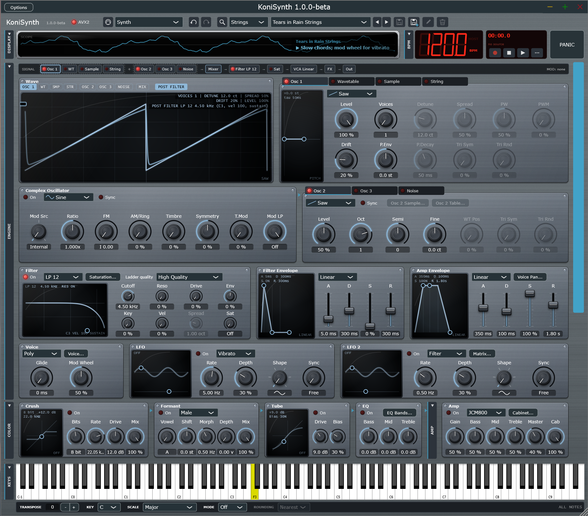

# KoniSynth

**Version 1.0.0-alpha** · by **@k0n1m4k1** 🇪🇸 · GNU AGPLv3

KoniSynth is an experimental synthesizer laboratory for the sounds of the 60s to the 90s: fifteen engines, from an analog-style
synth of its own to faithful emulations of the Casio VL-1, the Stylophone, the Omnichord, classic drum machines, the Yamaha
DX7, the NES and Game Boy, the Polivoks, the ANS, the Mega Drive, the SNES, the N64, the AdLib/Sound Blaster OPL chips and
the Roland MT-32. It runs as a **VST3** and **CLAP** plugin and as a **standalone** application on **Windows** and **Linux**.

## Philosophy

- **Faithful by default.** Every emulated engine aims to sound like the original hardware, *bugs and imperfections included*:
  the DX7's 12-bit phase and its floating DAC, the first-generation MT-32 digital overflow, the YM2612 "ladder" effect, the
  NES triangle that freezes on its last step, a non-oversampling DAC that holds each sample... Anything that makes an engine *nicer* than the
  original (smoother ramps, cleaner resampling, continuous velocity where the machine had two levels) exists only as an option,
  and it is **off by default**.
- **A synth with its own personality.** The *Synth* engine is not an emulation: it is KoniSynth's own design (physical drift,
  minBLEP oscillators, analog-style envelopes, 14 filter models, per-voice saturation, a modulation matrix, MPE).
- **Measure, don't guess.** Behaviour is checked against measurements (spectra, levels, pitch, timing) and, where it was
  unclear, against reference recordings. Sources for the hardware data are cited in the code comments.
- **Reproducible.** Randomness (drift, noise, analog tolerances) is seeded per project: a bounce sounds like what you heard.
- **Low latency.** No added latency by default: the limiter's look-ahead is optional and off.

## Engines

| Engine | What it is | Manual |
|---|---|---|
| Synth | KoniSynth's own analog-style synth: 4 sources (oscillator, wavetable, sample, plucked string), complex oscillator, 14 filters, matrix | [synth.md](docs/engines/synth.md) |
| Theremin | Physical model of the theremin (pitch and volume antennas) with its own pad; also playable from MIDI | [theremin.md](docs/engines/theremin.md) |
| Casio VL-1 | The 1979 VL-Tone: its sounds, ADSR digits and rhythms | [casio-vl1.md](docs/engines/casio-vl1.md) |
| Stylophone | The 1968 stylus organ (20 keys) and the experimental Gen X-2, with a gold-plate pad | [stylophone.md](docs/engines/stylophone.md) |
| Omnichord | Suzuki Omnichord: chord buttons, strum plate and rhythms | [omnichord.md](docs/engines/omnichord.md) |
| Drum Machine | TR-808, CR-78 and Mini Pops 7 voices with patterns | [drum-machine.md](docs/engines/drum-machine.md) |
| FM 6-Op | Yamaha DX7 (OPS chip arithmetic) with its 32 algorithms; loads DX7 SysEx banks | [fm-6op.md](docs/engines/fm-6op.md) |
| 8-Bit (NES / Game Boy) | 2A03 (NTSC/PAL), Famicom with VRC6, Game Boy / Color, with frame macros | [chip-8bit.md](docs/engines/chip-8bit.md) |
| Polivoks | The Soviet Polivoks synthesizer | [polivoks.md](docs/engines/polivoks.md) |
| ANS | The photoelectronic ANS synthesizer: draw the score | [ans.md](docs/engines/ans.md) |
| Mega Drive | YM2612 / YM3438 FM + SN76489 PSG + DAC | [mega-drive.md](docs/engines/mega-drive.md) |
| SNES | S-DSP: BRR samples, Gaussian interpolation, echo with FIR | [snes.md](docs/engines/snes.md) |
| N64 | RSP + libultra: VADPCM, resampling and its effects | [n64.md](docs/engines/n64.md) |
| OPL | YM3812 (OPL2), YMF262 (OPL3), YM2413 (OPLL) and Konami VRC7 | [opl.md](docs/engines/opl.md) |
| Roland MT-32 | MT-32 / CM-32L through Munt, with **your own ROMs** | [mt32.md](docs/engines/mt32.md) |

## Features

- **Effects chain** (each group can be folded or opened in its own window), in signal order:
  color (bit crusher, formant filter, tube, parametric EQ) → amp and cabinet (built-in or your impulse response) → dynamics
  (transient shaper, compressor) → modulation (phaser, flanger, frequency shifter) → ensemble (chorus, Leslie) → space (tape
  echo, plate reverb, spring reverb) → output (media: cassette, vinyl, reel tape at three speeds, underwater; master; limiter).
- **Performance:** arpeggiator, step sequencer, 8 performance macros, MIDI Learn on every knob and on the transport and PANIC
  buttons, MPE and polyphonic aftertouch (Synth), undo/redo.
- **Microtuning:** Scala `.scl`/`.kbm` files and MTS-ESP (all engines).
- **Transport:** record the session to WAV, play audio files, import and export MIDI.
- **Presets:** 332 factory presets (including recreations of popular instruments from the 60s to the 90s), user presets,
  favorites and a searchable browser with filters by category and engine. Presets that use your own files tell you when one
  is missing.
- **Your own content:** samples (WAV, AIFF, FLAC), SoundFont zones, SNES BRR/SPC, DX7 SysEx banks, impulse responses, Roland
  MT-32 ROMs. None of them is included; you supply them.
- **MIDI controllers:** setup profiles for the Akai Oxygen Pro Mini, Casio CT-S400, Yamaha PSR-EW425 and Yamaha reface YC.
- **Display:** oscilloscope, spectrum, spectrogram, goniometer, VU meters and **Arcade** (a pixel-art shooter played by the
  music), in modern, green or amber phosphor style, with an optional brass bezel. BPM display and transport next to it.
- **Interface:** collapsible blocks, floating windows (handy on multi-monitor setups), resizable window, tooltips on every
  control, right-click menu with Reset / Set value / MIDI Learn, skins (Default, Phosphor Green, Phosphor Amber, Brushed Metal).
- **Agent control (MCP):** an AI agent such as Claude can read and set parameters, browse and save presets, play and listen to
  KoniSynth (see [Agent control](#agent-control-mcp)).

## Installation

Download the zip for your system from the releases.

### Windows (x64)

| File | Copy to |
|---|---|
| `KoniSynth.vst3` (folder) | `C:\Program Files\Common Files\VST3\` (copy the whole folder) |
| `KoniSynth.clap` | `C:\Program Files\Common Files\CLAP\` (create it if needed) |
| `KoniSynth.exe` | anywhere (standalone application) |

No Visual C++ Redistributable is needed. If your DAW does not find the plugin:
1. Check the folder and rescan.
2. If the zip came from a browser or e-mail, right-click the zip **before extracting** → *Properties* → **Unblock**.
3. Windows 11 **Smart App Control** blocks unsigned DLLs (a `.vst3` is a DLL): the standalone may run while the plugin does
   not load. The binaries are not code-signed.

### Linux (x86-64)

| File | Copy to |
|---|---|
| `KoniSynth.vst3` (folder) | `~/.vst3/` |
| `KoniSynth.clap` | `~/.clap/` |
| `KoniSynth` | anywhere (standalone application; `chmod +x KoniSynth`) |

Built on Ubuntu 24.04; needs glibc 2.38 or newer (most distributions from 2023 on). Runtime libraries: ALSA, FreeType, Fontconfig and X11 (`libasound2`, `libfreetype6`,
`libfontconfig1`, `libx11-6`, `libxext6`, `libxrandr2`, `libxinerama1`, `libxcursor1`); JACK is optional. The Linux build
compiles cleanly but has **not been tested by hand yet**.

### macOS

Not available yet: building requires a Mac with Xcode. See [docs/BUILDING.md](docs/BUILDING.md).

## Quick start

1. **Engine** (top bar): pick an engine; it loads its most representative preset.
2. **Presets:** ◀ ▶ to step, the list to choose, the magnifier for the browser, the disk icons to save.
3. **Play:** the KEYS tab (on-screen keyboard), the PAD tab (Theremin and Stylophone), or any MIDI keyboard.
   In the standalone, *Options → Audio/MIDI config...* selects the audio device and MIDI inputs.
4. **Tweak:** hover any control for its help; right-click for Reset, Set value and MIDI Learn. Blocks fold with their tab.
5. **Menu** (*Options* in the standalone, right-click the *KoniSynth* title in the plugin): MIDI (channel, bend range,
   controller profiles), Tuning, Randomness, Skin, Agent (MCP) and About.

Each engine manual in [docs/engines](docs/engines) explains its controls and how to play it.

## Agent control (MCP)

KoniSynth can be driven by an AI agent through the [Model Context Protocol](https://modelcontextprotocol.io):

1. **Once:** in KoniSynth open *Agent (MCP)...* and use *Copy install command* (creates the bridge's Python environment) and
   *Copy Claude Code command* (registers it in Claude Code); run both in a terminal. Python 3.10+ is required.
2. **Every time:** turn *Agent control* on in that dialog and ask your agent to connect. The agent starts the bridge itself.

KoniSynth listens only on `127.0.0.1` (first free port in 47800-47899, announced with a random token); while it is off, no port
is open. Details and the list of tools: [Agent/KoniSynth-mcp/README.md](Agent/KoniSynth-mcp/README.md).

## Building from source

CMake 3.22+, a C++20 compiler (MSVC 2022+ or GCC 13+); JUCE 9.0.4 and clap-juce-extensions are fetched by CMake. Full steps for
Windows, Linux and macOS: [docs/BUILDING.md](docs/BUILDING.md).

## Tests

`python Tests/run_all.py` (needs the Release build of `KoniSynth_VST3` and `KoniBench`, and Python with numpy) runs:

| Suite | What it checks |
|---|---|
| `test_units.py` | Undo/redo, transport (WAV bit-exact, MIDI timing), Scala tuning, saturation |
| `test_regression.py` | Bit-exact renders of 12 engines with a fixed seed against stored hashes |
| `test_filters.py` | Filter responses and slopes (SVF, MS-20, comb, dual), Clean Drive |
| `test_voice.py` | Per-voice saturation (intermodulation, aliasing, level), analog VCA, microtuning, plucked string |
| `test_midi_learn.py` | MIDI Learn of parameters and actions stored in the state |
| `test_clap.py` | clap-validator (when `CLAP_VALIDATOR` points to it) |
| `test_mt32.py` | MT-32 without valid ROMs is silent and safe; with `KONI_MT32_ROMS_REAL` it checks that it sounds |
| `test_ui_reach.py` | Every parameter and every engine is reachable from the interface; one dropdown per section |

The VST3 also passes [pluginval](https://github.com/Tracktion/pluginval) at strictness level 10. `KoniBench` (in `Bench/`)
renders the plugin offline from the command line, for measurements.

## License

KoniSynth is free software under the **GNU Affero General Public License v3.0** ([LICENSE](LICENSE)). Copyright (C) 2026
@k0n1m4k1. It uses JUCE (under the AGPLv3), Nuked-OPLL (GPL-2.0+), Munt mt32emu (LGPL-2.1+), formulas from msfa (Apache-2.0)
and the MTS-ESP client (0BSD); their notices and licence texts are in [THIRD-PARTY-NOTICES.txt](THIRD-PARTY-NOTICES.txt).
Trademarks (Roland, Yamaha, Casio, Nintendo, Sega, Dubreq, Suzuki...) belong to their owners and are used only to describe what
each engine emulates. No ROM, sample or recording from those products is included.

## Credits

Design and direction: **@k0n1m4k1**. Developed with the help of Claude (Anthropic). Hardware research credits (Ken Shirriff's
DX7 analysis, blargg's SNES notes, Nuke.YKT, the Munt team, PolyValens' VL-1 emulator, Chordian's Omnichord data and many
others) are cited in the source and in THIRD-PARTY-NOTICES.txt.
