# Math Models

Math Models is a source tab of the [Synth](synth.md) engine: physical and stochastic models computed for every note.
Formula... shows each formula, what KoniSynth adapts and the wave it gives.

## Models at a glance

| Model | Published model | What it is | Own controls |
|---|---|---|---|
| Noise Burst | Karplus & Strong 1983; Jaffe & Smith 1983 | Plucked string started by a filtered noise burst. | Decay, Bright, Position, Damping, Pickup, Buzz, Harmonic, Stiff, Tension |
| Pick | Jaffe & Smith 1983 | Plucked string started by a triangle with its tip at Position. | as Noise Burst |
| Bow | McIntyre, Schumacher & Woodhouse 1983; Smith 1986 | Bowed string (stick-slip friction) while the key is held. | Decay, Bright, Position, Pickup, Press, Harmonic, Stiff, Tension |
| Hammer | Hall 1992 | String struck by a felt hammer (nonlinear spring). | as Bow, with Felt |
| E-Bow | after Heet's patent, 1978 (own model) | Electromagnet driving the string while the key is held. | as Bow, with Drive |
| Modal | Adrien 1991 | Sum of fading sines; recipe edited in Formula... | Decay |
| Reed | Guillemain, Kergomard & Voinier 2005 | Clarinet: reed on a cylindrical bore. Velocity = blowing pressure. | Embouchure, Noise |
| Flute | Karjalainen et al. 1991; Välimäki et al. 1992; STK Flute | Air jet across an open tube. | Jet, Noise |
| Brass | Cook 1991 (TBone); STK Brass | Buzzing lips on a tube. | Lip, Slide |
| Banded | Essl & Cook 1999; STK BandedWG | Bar, glass or bowl: one loop per mode, struck or bowed. | Decay, Shape, Excite, Press (with Bow) |
| Shaker | Cook 1997 (PhISEM); STK Shakers | Random collisions of beans or jingles through a few resonances. | Type, Objects, Shake, Tone |
| Mallet | Avanzini & Rocchesso 2001 | A mallet with a nonlinear felt strikes the modes of the Modal recipe. | Decay, Hardness, Mass, Damp |

## Controls

The panel shows only the controls of the chosen model, always in the same order. Level (0-100 %, default 0 %) is the volume
of every model.

| Control | What it does | Range / default |
|---|---|---|
| Decay | Time to fall by 60 dB (Modal, Banded and Mallet: scales every decay, x1 at 3 s). | 0.10-20 s / 3.00 s |
| Bright | Low = soft finger, high = hard plectrum or harpsichord quill. | 0-100 % / 60 % |
| Position | Pluck, bow, hammer or coil position: near the end bright and thin, the middle hollow. | 2-50 % / 13 % |
| Damping | Upper partials die out sooner than the fundamental; fundamental Decay and tuning are compensated. | 0-100 % / 0 % |
| Pickup | Magnetic pickup position from the bridge; harmonic k is shaped by 2·abs(sin(π·k·position)). | Off-50 % / Off |
| Stiff | String models: stiffness, the inharmonicity B of f_k = k·f0·sqrt(1 + B·k²), from 0.00001 to 0.001 (logarithmic). | Off-100 % / Off |
| Tension | String models: tension modulation; a loud note starts sharp and settles as it fades (at 100 % and velocity 127, up to a semitone). | Off-100 % / Off |
| Press | Bow pressure (Bow; Banded when bowed, dimmed when struck): too little or too much stops the steady tone. | 0-100 % / 50 % |
| Shape | Banded object: Uniform Bar, Tuned Bar (vibraphone bar), Glass Harmonica, Tibetan Bowl (12 measured modes). | 4 shapes / Tuned Bar |
| Excite | Banded: Strike (rings on its own) or Bow (while the key is held; half its level in about 1 s). | Strike, Bow / Strike |
| Type | Shaker instrument: Maraca, Cabasa, Sekere, Tambourine, Sleigh Bells, Bamboo Chimes. | 6 types / Maraca |
| Objects | Shaker pieces, a quarter to four times the instrument's: few = clicks, many = a smooth hiss. | 0-100 % / 50 % |
| Shake | How long one shake lasts. | 0-100 % / 50 % |
| Tone | Shaker resonances, one octave down to one octave up, on top of the note (at C4, the instrument). | 0-100 % / 50 % |
| Hardness | Mallet: hardness of the head, as its contact time on a rigid surface at speed 1 (logarithmic, at least 8 samples): soft felt rings only the low modes, hard plastic every mode. | 10 ms (0 %) to 0.3 ms (100 %) / 50 % (1.7 ms) |
| Mass | Mallet: mass of the head, 0.01 to 10 times the modal mass (logarithmic): light = one clean bounce; from about 0.3 it bounces 2 to 10 times and damps the modes. | 0-100 % / 33 % (0.1) |
| Damp | Mallet: losses of the felt, μ from 0 to 1.5: low = an elastic, ringing bounce; high = a dull, padded one (restitution about 1 - (2/3)·μ·v). | 0-100 % / 20 % (μ 0.3) |

With Mallet, velocity sets the strike speed, v = 0.2 + 0.8 x velocity (0-1).

## Measurements

Measured with KoniBench at 48 kHz (A3, velocity 100: every model peaks near 0.125):

| Model | Tuning | Against a recording (University of Iowa MIS, C4) | CPU, 8 notes |
|---|---|---|---|
| Banded, Tuned Bar | mode 1 within 1 cent, C2 to C7 | bowed: half level in 0.76 s (vibraphone 0.79 s); struck: see Banded below | +1.0 points |
| Shaker, Maraca | - | - | +0.2 points |
| Mallet, Soft Key | - | - | +0.07 points |
| Pick + Stiff 50 % + Tension 50 % | partials 1-16 within 1 cent at B = 1e-4 (C1 to A4) | - | +2.3 points over Pick |

## Why these models are not in the classic synthesizers

Every model on this page computes each output sample from the previous ones: a delay line one period long per note (8192 samples of buffer per string here), a nonlinear function (friction table,
reed flow, jet, lip) and several multiplications per sample. A voltage-controlled circuit has no sample memory to hold a
period, and the models themselves arrived late: Karplus and Strong developed their plucked string around 1979 on an Intel
8080A microprocessor, where it played two or three voices in real time, and published it in 1983, the year McIntyre,
Schumacher and Woodhouse published their study of the oscillations of bowed strings, reeds and flutes. Yamaha began developing Julius Smith's digital
waveguides, licensed from Stanford, in 1989; the result, the VL1, was introduced at the 1994 NAMM show and, "because of the
heavy computing involved", played two notes at a time. Korg followed with the Prophecy (a 37-key monosynth with plucked,
brass and reed models, reviewed in October 1995) and the Z1 (12 voices, described by Sound On Sound in 1997 as the first
multitimbral physical modelling synthesizer).

## STK

Bow, Flute, Brass, Banded and Shaker follow the classes of the same name in the Synthesis ToolKit in C++ (STK) by
Perry R. Cook and Gary P. Scavone: a set of C++ classes for audio signal processing and synthesis that grew from a NeXTSTEP
toolkit Cook wrote at Stanford's CCRMA in the early 1990s, was ported to C++ when he moved to Princeton in 1996 and has been
distributed since then; Scavone joined in 1997. It was presented at ICMC 1999 in Beijing ("The Synthesis ToolKit (STK)") and
is still maintained (copyright 1995-2023). Its licence is a permissive MIT-style licence (reproduced in
THIRD-PARTY-NOTICES.txt) with a non-binding request to send modifications back. KoniSynth re-implements the algorithms (it
does not copy STK code) and documents each change below.

## Models

This section covers each model: its formula, where it was published and what KoniSynth changes. In the formulas,
f is the note frequency, f_s the sample rate, v the velocity (0-1), and LP, HP and DC a low-pass, a high-pass and a DC
blocker. Images marked "Adapted by KoniSynth" contain lines that differ from the published model.

Common to the string models (Noise Burst, Pick, Bow, Hammer, E-Bow): the string is a delay loop whose length sets the
pitch, read with Hermite interpolation (fractional, so bend and vibrato glide). Decay sets the loss per period (T60 of the
fundamental). Harmonic n plays the string as if a finger damped the node at 1/n, so only modes k·n remain. Pickup filters
the output as a magnetic pickup at that position. A DC blocker at 20 Hz follows every model except Modal, Banded and Mallet.

### Stiff and Tension (string modifiers)

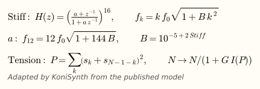

*Origin.* Stiffness makes the partials of a real string sharp, f_k = k·f0·sqrt(1 + B·k²) (Fletcher, Blackham and Stratton,
JASA 1962). Van Duyne and Smith (ICMC 1994) modelled it with a cascade of identical first-order all-pass filters in the
waveguide loop, and Rauhala and Välimäki (DAFx 2006, after their tunable dispersion filter of IEEE SPL 2006) gave closed-form
formulas for its coefficient. Tension modulation is the elongation of a string that vibrates widely: Välimäki, Tolonen and
Karjalainen (ICASSP 1999; IEEE Trans. Speech and Audio Processing, 2000) shorten the delay loop with a power of the string
slopes, P = Σ (s_k + s_N-1-k)², integrated by a one-pole filter, so the pitch starts sharp, settles as the tone decays and
partials missing from the pluck appear.

*In KoniSynth.* Both act on Noise Burst, Pick, Bow, Hammer and E-Bow; at 0 the loop is unchanged (bit for bit).

- Stiff: 16 first-order all-pass filters, B = 10^(-5 + 2·Stiff). The closed-form coefficient of Rauhala and Välimäki was
  measured in a prototype: within 1.8 cents for partials 1-12 up to C4 with B ≤ 1e-4, but with B = 1e-3 it stretches partial
  12 by 80 of the 116 cents and above C5 it bends the partials flat (-27 cents). Here the coefficient is solved (bisection on
  the coefficient, Newton on the loop phase) so that partial 12, or the highest below 0.45·f_s, lands exactly, and the delay
  of the cascade at the note is taken out of the loop. Measured in the plugin (Pick, A1 to A4): partials 1-16 within 1 cent
  at B = 1e-4 and within 16.5 cents (35 at A4) at B = 1e-3; the fundamental within 0.9 cents.
- Tension: the power is taken relative to its peak in the note, δ = Tension·0.06·velocity²·P/P_max, and the loop lasts
  N/(1 + δ). With the absolute power of the paper the triangle of Pick started 3 semitones sharp at 30 %. In Bow, Hammer and
  E-Bow the power is the energy of the two velocity loops (no cross term). The pole sits at the note frequency (the paper
  gives no value; it passes the 2f oscillation at -7 dB). Measured (C3, velocity 127, Tension 100 %): Pick +32 cents at
  20 ms, +37 at 0.25 s, +9 at 1 s, +3 at 1.8 s; Hammer +81, +30, +7, +2; a held Bow or E-Bow stays about +100 cents sharp
  while its amplitude holds.

### Noise Burst

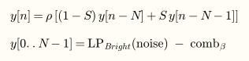

*Origin.* Kevin Karplus and Alex Strong published "Digital Synthesis of Plucked-String and Drum Timbres" in the Computer
Music Journal 7(2), 1983, pp. 43-55. A delay line filled with noise and averaged on every pass gives a decaying, plucked
tone at almost no computational cost; Karplus dates the technique to about 1979, running on an 8080A microprocessor. In the
same issue (pp. 56-69), David A. Jaffe and Julius O. Smith published "Extensions of the Karplus-Strong Plucked-String
Algorithm": a pick-direction low-pass, a pick-position comb filter, a first-order all-pass for fine tuning, a dynamic-level
low-pass and filters for string damping and stiffness. KoniSynth follows this extended form.

*In KoniSynth.* The burst is one period of white noise, low-pass filtered by Bright (dynamic-level filter, corner
200 Hz·2^(7·Bright)) and comb filtered at Position (β), with its mean removed and normalised to a 0.8 peak. The loop
averages each sample with its neighbour (weight S) and scales it by ρ; S and ρ are computed per block so the fundamental
falls 60 dB in Decay. Where the plain average loses too much (cos(ω/2) < g: above about 650 Hz with Decay at 3 s), S is
reduced instead and ρ is 0.99999 (measured: Decay within 1 % up to 1.3 kHz). Fractional tuning uses Hermite interpolation instead of the all-pass. Damping (an extra one-pole
loss whose phase delay and gain at the fundamental are compensated) and Pickup are KoniSynth additions.

*Buzz.* With Buzz above 0, Noise Burst and Pick add a sitar-like bridge after Sadjad Siddiq, "A Physical Model of the
Nonlinear Sitar String", Archives of Acoustics 37(1), 2012, pp. 73-79, which models the string's motion against a curved
bridge that obstructs it and compares it with recordings.

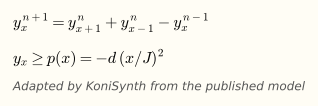

Siddiq solves the whole string by finite differences; KoniSynth solves only the 1 % of the string next to the bridge
(J points, 2 to 256) and keeps the rest as the tuned delay loop, so Decay, Damping and fractional tuning still apply (a whole
finite-difference string would round its length: -16 cents at A4, measured). The bridge profile p(x) = -d·(x/J)², with d
from 2.5 % (lowest Buzz) to 0.5 % (Buzz 100 %) of the excitation amplitude. On contact only the new position of a point is
clamped (clamping the previous one as well made the scheme diverge at the Nyquist mode in the prototype); the segment has
no losses or stiffness of its own.

### Pick

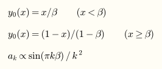

*Origin.* Jaffe and Smith (1983, above) describe the plucked string's initial shape: a string pulled aside at a point β of
its length and released starts as a triangle, and its harmonic k has amplitude proportional to sin(πkβ)/k².

*In KoniSynth.* The triangle has its tip at Position; Bright rounds the tip with a low-pass run forward and backward (no net
delay), as a wider plectrum or a finger would. In the ideal model the tip is sharp. Then the loop of Noise Burst; Buzz as in
Noise Burst. Pick uses no random numbers.

### Bow

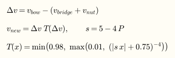

*Origin.* Michael E. McIntyre, Robert T. Schumacher and James Woodhouse, "On the oscillations of musical instruments", J.
Acoust. Soc. Am. 74(5), 1983, pp. 1325-1345, treated the self-sustained oscillations of the bowed string, the reed and the flute
within one framework. Julius O. Smith turned the bowed string
into a digital waveguide in "Efficient simulation of the reed-bore and bow-string mechanisms" (ICMC 1986, The Hague); his
waveguide synthesis is summarised in "Physical modeling using digital waveguides", Computer Music Journal 16(4), 1992. The
STK Bowed class describes itself as "a bowed string model, a la Smith (1986), after McIntyre, Schumacher, Woodhouse (1983)":
two delay lines meet at the bow, and a friction table T passes most of the velocity difference when it is small (the bow
grips) and little when it is large (it slips), which gives the Helmholtz motion. P = Press, v_bow = 0.03 + 0.2·v (as STK).

*In KoniSynth.* STK's bridge loss is a fixed one-pole low-pass with gain 0.95 and pole 0.75 - 0.2·22050/f_s (0.658 at
48 kHz), and its loop subtracts 4 samples for the filter delay; its output goes through six body filters. KoniSynth takes the
pole from Bright and the gain from Decay (the same loss per period as the plucked string), subtracts the filter's exact phase
delay at the fundamental, and outputs the wave at the bridge (no violin body). The bow speeds up in 20 ms (estimated) and is
lifted at once when the key is released: with the bow resting on the string, the string was damped to -38 dB in 0.6 s
instead of -12 dB (Decay 3 s, measured).

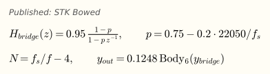
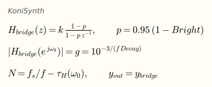

### Hammer

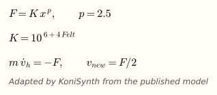

*Origin.* Donald E. Hall, "Piano string excitation. VI: Nonlinear modeling", J. Acoust. Soc. Am. 92(1), 1992, pp. 95-105,
the sixth part of his series on piano string excitation, models the felt as a nonlinear spring: the force grows as a power of the felt
compression, F = K·x^p. Daniel A. Russell's measurements ("The piano hammer as a nonlinear spring") give p from 2.2 to 3.5
in static tests of hammers taken from pianos (1.5 to 2.8 for unused hammers) and 2 < p < 3 as the range players prefer.

*In KoniSynth.* x = felt compression, m = hammer mass, Felt sets the stiffness K, and the string receives F/2 on each side
of the hammer. Units are KoniSynth's own (string impedance 1, mass 0.001) and p = 2.5, inside the measured range. The
integration is explicit Euler with K limited to 10^10 (10^12 diverges at 44.1 kHz), and the hammer stops being computed
20 ms after it leaves the string. A harder or faster strike gives a shorter contact and a brighter tone: 5.2 ms (K = 10^6)
to 1.5 ms (K = 10^10) at velocity 0.8, measured in the prototype.

### E-Bow

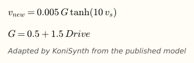

*Origin.* Gregory S. Heet's US patent 4,075,921, "String instrument vibration initiator and sustainer" (filed 1976,
granted 28 February 1978), describes a hand-held device that senses a string's vibration with one coil and sustains it with
another. The EBow, invented by Heet, was introduced at the 1976 NAMM show.

*In KoniSynth.* There is no published synthesis model of the device; this one is KoniSynth's own. A coil at Position senses
the string speed v_s and drives the string with it, amplified (G from Drive) and saturated by tanh, while the key is held.
It starts from a tiny seeded noise and grows: half its final level in 0.81 s (lowest Drive) to 0.35 s (highest), measured in
the prototype.

### Modal

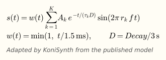

*Origin.* Modal synthesis describes a vibrating object by its modes, each a frequency, a level and a decay. Jean-Marie
Adrien's chapter "The missing link: Modal synthesis", in De Poli, Piccialli and Roads (eds.), Representations of Musical
Signals (MIT Press, 1991), pp. 269-297, is the reference this model follows.

*In KoniSynth.* Each mode k is a sine at r_k times the note with level A_k and time constant τ_k, computed with a phase
accumulator, so bend, vibrato and drift move it sample by sample. w(t) is a 1.5 ms fade-in; D scales every τ (Decay, x1 at
its default of 3 s), and the decays do not change with the note. Modes above 0.45·f_s are muted. The output is normalised
to a peak of 1 at C4. Recipes: Soft Key (harmonic 1, 2, 3, 7), Metal (inharmonic 1, 2.73, 5.41, 8.17) and Custom (up to 8
modes edited in Formula...; Level 0 leaves a mode out). Position, Bright, Damping, Pickup, Buzz and Harmonic have no effect.

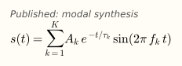

### Reed

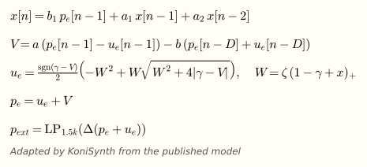

*Origin.* Philippe Guillemain, Jean Kergomard and Thierry Voinier (CNRS, Laboratoire de Mécanique et d'Acoustique,
Marseille), "Real-time synthesis of clarinet-like instruments using digital impedance models", J. Acoust. Soc. Am. 118(1),
2005, pp. 483-494. Instead of travelling waves it uses the sampled physical variables: p_e (pressure in the mouthpiece), u_e
(flow) and x (reed opening). The reed is a damped mass on a spring, the flow through it follows Bernoulli and is solved
exactly each sample (an explicit second-order equation, W is the opening), and the cylindrical bore answers through its
impedance: two loops of D samples (half a period) with the losses of the bore in a one-pole filter (a, b). γ is the blowing
pressure and ζ the embouchure. The sound is the pressure outside the bell, approximated in the paper by the time derivative
of p_e + u_e (its equation 13).

*In KoniSynth.* Measured against recordings of a B♭ clarinet (University of Iowa MIS, pp, mf and ff at C4: harmonics within
4 to 8 dB):

- Reed damping q_r = 0.6. The paper's example (figure 14) uses 0.3; with it the model squeaks on the third mode in C4 with
  slow attacks.
- A one-pole low-pass at 1.5 kHz on the outside pressure: the paper notes that the derivative overestimates the high
  frequencies.
- A fractional delay with the phase delay of the loss filter and a reed length correction (1.8·10^-5 s) taken out. The paper
  uses a whole number of samples (it judged a fractional delay line unnecessary in a first step). Tuning: within 7 cents from
  C2 to C6.
- γ from velocity: 0.34 (soft) to 0.45 (loud); the reed speaks above 1/3. Above about 300-380 Hz γ stays at 0.40 or more
  (lower, the model jumps to the third mode, measured at G4 and C5). Noise adds ±5 %·Noise of breath noise to γ.
- The radiated level grows about 6.4 dB per octave from C2 to C6 (measured); it is evened out along the keyboard by
  (261.63 Hz / f), limited to x1/16-x16.

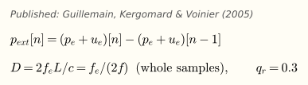
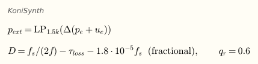

### Flute

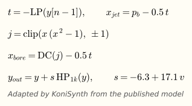

*Origin.* Matti Karjalainen, Unto K. Laine, Timo I. Laakso and Vesa Välimäki presented transmission-line models of string and
wind instruments running in real time at ICMC 1991 in Montreal ("Transmission-line modeling and real-time synthesis of string
and wind instruments"), and Välimäki, Karjalainen, Zoltán Jánosy and Laine "A real-time DSP implementation of a flute model"
at IEEE ICASSP 1992 in San Francisco. The STK Flute class implements "a simple flute physical model, as discussed by
Karjalainen, Smith, Waryznyk, etc. The jet model uses a polynomial, a la Cook": a tube and an air jet that crosses the mouth
hole and takes a while to reach the edge (Jet), where it splits in and out of the tube, approximated by x(x² - 1) clipped to
±1. The tube reflects half of the wave at each end (0.5), with a one-pole low-pass as its losses.

*In KoniSynth.* Measured against recordings of a flute (University of Iowa MIS, C4):

- STK's bore has one inversion, like a pipe closed at one end, and is tuned to 2/3 of the note (1.5 periods, overblown), so it
  has no even harmonics: H2 26 dB down against 0 dB in the flute. Here the bore is open at both ends (two inversions, one
  period) and the jet loop is two periods with the DC blocker's phase taken out: in tune within 22 cents.
- STK's jet does not brighten when blown harder, so a tilt with velocity does it: y + s·HP_1k(y), s = -6.3 + 17.1·v,
  calibrated, not physical. Spectral centroid 1.14, 2.81 and 3.39·f0 at pp, mf and ff against 1.09, 2.78 and 3.52·f0 in the
  flute. The level change of the tilt is divided out (1 / (1 + 0.6·s)).
- Blowing pressure (1 + 0.3·v)/0.8 instead of STK's (1.1 + 0.2·v)/0.8: above it the model has two regimes and the noise
  picks one (centroid 1.66 or 2.73·f0 depending on the seed, measured).
- No built-in vibrato (LFO and matrix do it), seeded noise (Noise: 0.4·Noise as in STK), envelope rates scaled from STK's
  44.1 kHz to any sample rate.

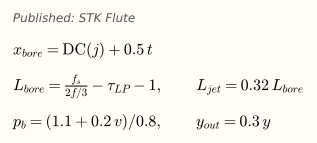
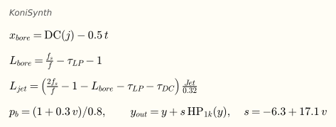

### Brass

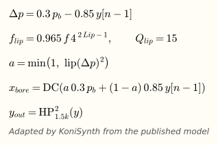

*Origin.* Perry R. Cook, "TBone: An interactive WaveGuide brass instrument synthesis workbench for the NeXT machine", ICMC
1991, Montreal, pp. 297-299. The STK Brass class implements "a simple brass instrument waveguide model, a la Cook (TBone,
HosePlayer)": the lips are a mass on a spring, a resonant filter tuned to f_lip and driven by the pressure difference between
the mouth and the tube. Its output squared, limited to 1, is the opening a of the lips, which mixes mouth and tube pressure
into the tube. The tube is two periods long and the lips lock to its harmonic nearest to f_lip; Lip (STK's Lip Tension,
f·4^(2·Lip - 1)) moves between them, and Slide scales the tube from 0.5 to 1.5 times.

*In KoniSynth.* STK fixes the lip filter's pole radius at 0.997 (a bandwidth of about 46 Hz at 48 kHz) and its gain at 0.03.
The static gain of that filter from the mouth to the lips is g·M/(1 - 2r·cos ω + r²), and the denominator falls roughly as
ω² at low frequencies: below a lip frequency of about 650 Hz the breath alone holds the lips wide open (area saturated at 1,
so the opening no longer changes with the pressure) and the model does not oscillate. Measured: silent from C2 to C4, and
+16 cents at C5, +27 cents at C6. KoniSynth keeps the lip Q at 15 on every note and sets the gain so the static opening is
the same everywhere (0.7 for a breath of M = 0.24, velocity 0.8), and tunes the lip 3.5 % below f (0.965·f, -62 cents): a lip
that opens outwards sounds above its resonance. The tube is two exact periods with the DC blocker's phase taken out (STK:
2·f_s/f + 3). Measured in the prototype: within ±3 cents from C4 to C6 and ±21 cents from C2 to C3 (the dialog's summary:
within 17 cents from C2 to C6). STK outputs the pressure inside the tube; the sound of a trumpet is what leaves the bell,
which lets the highs out, so a second-order high-pass at 1.5 kHz follows: at C4 mf, centroid 4.70·f0 against 5.12·f0 for a
trumpet (University of Iowa MIS), 2.05·f0 without it; brightness within 8 % at mf and ff. The level, +7 dB per octave from C2
to C6 (measured), is evened out by (261.63 Hz / f)^1.15, limited to x1/16-x16.

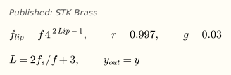
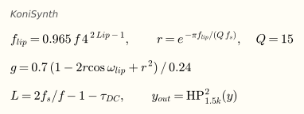

### Banded

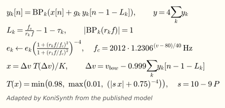

*Origin.* Georg Essl and Perry R. Cook, "Banded Waveguides: Towards Physical Modeling of Bowed Bar Percussion Instruments",
ICMC 1999, Beijing, pp. 321-324. A bar's modes are not harmonic, so a single delay loop cannot hold them; a banded waveguide
gives each mode its own loop, a delay of one period of that mode and a narrow band-pass that lets only that mode circulate.
Their measurements of bowed bars followed in "Measurements and efficient simulations of bowed bars", J. Acoust. Soc. Am.
108(1), 2000, pp. 379-388, and the Tibetan bowl and glass harmonica in "Banded Waveguides on Circular Topologies and of
Beating Modes: Tibetan Singing Bowls and Glass Harmonicas" (ICMC 2002, Göteborg). The STK BandedWG class ("by Georg Essl,
1999--2004", modified for STK 4.0 by Gary Scavone) has the four shapes used here: Uniform Bar, Tuned Bar (vibraphone),
Glass Harmonica and Tibetan Bowl (12 measured modes). Strike fills every loop at once; Bow drives them all with the friction
table T of a bow (P = Press) and the difference between the bow speed and the sum of the loops.

*In KoniSynth.*

- STK rounds each delay to whole samples, so the modes fall off the centre of their band-pass and lose gain. Here the delay
  is fractional with the band-pass phase delay taken out, and the band-pass gain at its centre is 1: every mode in tune
  (prototype: within 1 cent; STK up to 12.5 cents off, Tibetan Bowl at C6, 48 kHz).
- Decay scales every loss (x1 at 3 s); the bowl's lossless modes (gain 1 in STK) get 0.9995 per trip, as with the mode
  centred they would never decay.
- STK limits the note to 1568 Hz; here a mode is muted above 0.45·f_s or when its delay drops below 1 sample.
- A bowed note starts with a light strike (0.1·velocity), the bow touching the bar: from rest STK's bow took 1.65 s to reach
  -6 dB of its steady level, with it 0.95 s (Tuned Bar at C4, prototype).
- Struck bars (Uniform Bar and Tuned Bar) use a soft mallet. STK's strike fills every loop with the same excitation·a/K; here
  each mode's initial excitation is weighted by an 8th-order low-pass normalised to mode 1, its cutoff f_c opening with
  velocity (2012 Hz at velocity 80, 2476 Hz at 120). Glass Harmonica and Tibetan Bowl keep STK's excitation. Fitted by least
  squares to the strikes of a vibraphone (University of Iowa MIS, sustain, C4 to B4), assuming mf = velocity 80 and
  ff = 120:

| Mode 4 / mode 10, relative to mode 1 | mf / velocity 80 | ff / velocity 120 |
|---|---|---|
| Vibraphone (median) | -25.8 / -83.9 dB | -19.4 / -72.5 dB |
| KoniSynth | -24.5 / -75.0 dB | -20.8 / -65.0 dB |
| STK excitation (any velocity) | -11.8 / -25.2 dB | -11.8 / -25.2 dB |

The recording spreads ±7-13 dB from note to note (the strike position against each mode's nodes); that is not modelled.

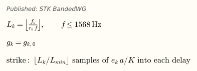
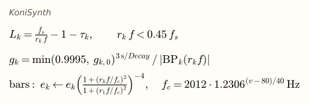

### Shaker

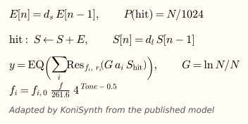

*Origin.* Perry R. Cook, "Physically Informed Sonic Modeling (PhISM): Synthesis of Percussive Sounds", Computer Music
Journal 21(3), 1997, from p. 38. Its stochastic branch, PhISEM (Physically Informed Stochastic Event Modeling), does not
simulate each bean: a shake gives energy E that fades (d_s), each sample a collision happens with probability N/1024
(N objects) and adds E to the sound level S, which fades much faster (d_l), and S drives a few resonances (the shell, the
jingles) and a final filter. More objects give a smoother, quieter hiss (gain ln N / N). The STK Shakers class implements
it for maracas, cabasa, sekere, tambourine, sleigh bells, bamboo chimes and more; Tambourine, Sleigh Bells and Bamboo Chimes
move their resonances a little at each hit.

*In KoniSynth.* STK's constants are per sample at 44.1 kHz; here decays, collision probability and pole radii are scaled
to keep their timing at any sample rate. The resonances follow the note (at C4, STK's instrument) and Tone (STK's resonance
frequency control, x4^(Tone - 0.5)); Objects goes from a quarter to four times the instrument's count. STK goes silent the
moment the energy drops below 0.001, cutting the resonances (a click); here only the collisions stop and the resonances ring
out. Collisions use the voice's seeded random generator.

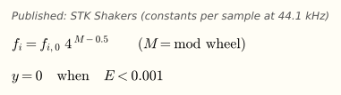
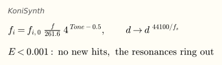

### Mallet

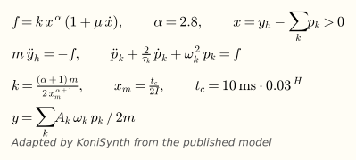

*Origin.* Federico Avanzini and Davide Rocchesso, "Modeling collision sounds: non-linear contact force", Proceedings of the
COST G-6 Conference on Digital Audio Effects (DAFx-01), Limerick, Ireland, 6-8 December 2001
([PDF](https://avanzini.di.unimi.it/downloads/publications/avanzini_dafx01_revised.pdf)). A lumped hammer strikes a
resonator made of second-order oscillators, one per partial, through the contact force
f(x, ẋ) = -k·x^α - λ·x^α·ẋ = -k·x^α·(1 + μ·ẋ), where x is the compression of the felt and μ = λ/k. The force law was
proposed by David W. Marhefka and David E. Orin for the simulation of robotic systems ("A compliant contact model with
nonlinear damping for simulation of robotic systems", IEEE Transactions on Systems, Man, and Cybernetics, Part A, 29(6),
1999, pp. 566-572); its damping term, proportional to x^n·ẋ, was introduced by K. H. Hunt and F. R. E. Crossley,
"Coefficient of restitution interpreted as damping in vibroimpact", Journal of Applied Mechanics 42(2), 1975,
pp. 440-445. The paper chooses α = 2.8, "close to values found in piano hammer felts". The dissipative term is zero at zero
compression, and the force never turns inward (sticky) on a strike that starts at the surface. The contact time shapes the
attack: a short contact gives a rich spectrum and a bright attack, a long one a smooth attack. The paper solves the
delay-free loop between force and motion with the K method of Borin et al. and computes f each sample by Newton-Raphson
iteration (never more than four iterations). The work was supported by the EU project SOb, "the Sounding Object"
(IST-2000-25287). The Sound Design Toolkit (SDT, GPL-3.0, [github.com/SkAT-VG/SDT](https://github.com/SkAT-VG/SDT)),
developed with SOb (2001-2003) and later EU projects, implements this impact as `SDTImpact_MarhefkaOrin`: the force is
computed explicitly from the state of the previous sample, and the resonators are modal, each mode a damped oscillator.

*In KoniSynth.* A mallet of mass m strikes the modes of the Modal recipe (Soft Key, Metal or Custom with up to 8 modes,
edited in Formula...). Each mode k is a damped oscillator of unit mass with the recipe's ratio r_k and decay τ_k, scaled
by Decay as in Modal (x1 at 3 s), discretised as in SDT (the exact response of the oscillator to the force). Velocity sets the
strike speed, v = 0.2 + 0.8 x velocity (0-1): with v equal to velocity the level spanned 26.5 dB from 30 to 127. A harder or faster strike gives a shorter contact and a brighter tone; a heavy mallet bounces several
times and damps the modes. Changes from the paper:

- k comes from the contact time t_c set by Hardness (on a rigid surface at speed 1; 10 ms·0.03^Hardness, at least 8
  samples), through the Hertz impact integral: x_m = t_c/(2I), I = √π·Γ(1 + 1/(α+1)) / Γ(1/2 + 1/(α+1)),
  k = (α+1)·m / (2·x_m^(α+1)). Hardness therefore does not depend on Mass.
- Every mode has unit mass and gain 1 at the struck point, and is heard as A_k·ω_k·p_k / (2m), so a hard, light strike
  sounds like the recipe.
- The force is explicit, from the previous sample, as in SDT; the paper iterates Newton-Raphson within the sample.
- Mass sets m from 0.01 to 10 times the modal mass: at 0.1 (default) one clean bounce; from about 0.3, 2 to 10 bounces.
  Damp sets μ from 0 to 1.5; the restitution is about 1 - (2/3)·μ·v.

Measured in the prototype at 48 kHz (Soft Key recipe, C4, Hardness for a 1 ms contact):

| | Strike speed 0.3 | Strike speed 0.8 | Soft Key recipe |
|---|---|---|---|
| Contact time | 1.58 ms | 1.08 ms | - |
| Modes 2 / 3 / 7, relative to mode 1 | -13.2 / -28.0 / -83.5 dB | -12.0 / -24.9 / -55.9 dB | -9.9 / -18.4 / -24.4 dB |

On a rigid surface the Hertz law gives t_c ∝ v^(-(α-1)/(α+1)) = v^-0.47: 1.77 ms and 1.11 ms at these speeds
(calculated); the compliant modes make the measured times shorter at low speed.

Measured in the plugin (KoniBench, A3, defaults): the level spans 21.4 dB from velocity 30 to 127, and with the default head
(1.7 ms) high notes are softer than A3: C6 -8.3 dB, C7 -17.5 dB (the contact lasts longer than their period).

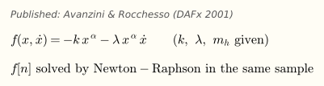
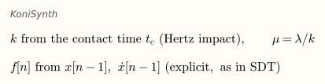
